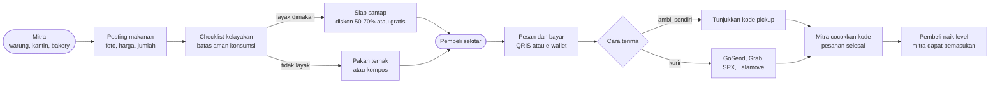
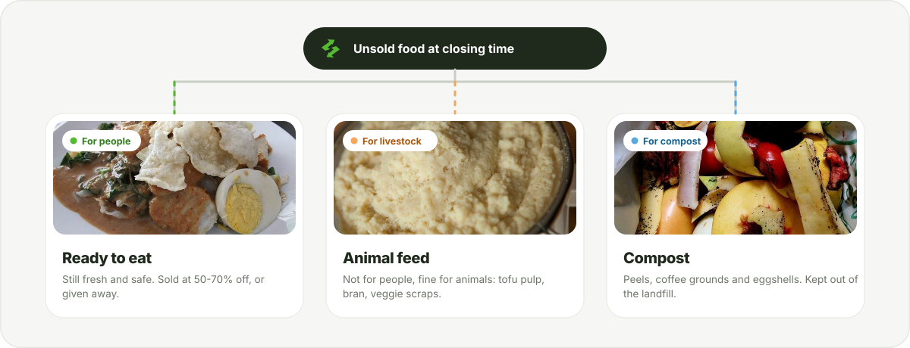

<p align="center">
  
</p>

# SisaGuna

Aplikasi Android untuk menyelamatkan makanan berlebih dari UMKM kuliner. Warung, kantin, bakery, dan resto kecil memposting makanan yang masih layak sebelum toko tutup, dengan harga jauh lebih murah atau gratis. Pembeli di sekitar memesan lewat aplikasi, lalu mengambil sendiri atau memakai kurir. Sisa yang tidak layak dimakan manusia disalurkan untuk pakan ternak dan kompos.

**Mata kuliah:** Venture Creation (ENPR6312), BINUS University
**Kelompok:** Group 4, Kelas LZ01
**Tema:** Lingkungan Alam

---

## Daftar Isi

1. [Apa Itu SisaGuna?](#apa-itu-sisaguna)
2. [Coba Aplikasinya](#coba-aplikasinya)
3. [Masalah dan Solusi](#masalah-dan-solusi)
4. [Fitur Utama](#fitur-utama)
5. [Model Bisnis](#model-bisnis)
6. [Status Pengerjaan](#status-pengerjaan)
7. [Tech Stack](#tech-stack)
8. [Struktur Project](#struktur-project)
9. [Menjalankan dari Source Code](#menjalankan-dari-source-code)
10. [Tim](#tim)
11. [Link Terkait](#link-terkait)

---

## Apa Itu SisaGuna?

Bayangkan jam 8 malam di sebuah warung. Gado-gado masih banyak, tapi sebentar lagi tutup. Biasanya makanan itu dibuang. Di sisi lain, ada orang di sekitar yang mau makan enak dengan harga murah.

**SisaGuna mempertemukan keduanya.** Penjual memotret makanan sisa, aplikasi mengecek kelayakannya, dan pembeli terdekat memesan dengan potongan harga 50-70% atau gratis. Makanan yang tidak lagi layak untuk manusia tidak dibuang: disalurkan ke peternak sebagai pakan atau ke tukang kebun sebagai kompos.

**Tiga hasilnya:** penjual tetap dapat pemasukan, pembeli hemat, dan sampah organik berkurang.

### Alur aplikasi



### Ke mana sisa makanan pergi

<p align="center">
  
</p>

---

## Coba Aplikasinya

**Download APK:** buka halaman [Releases](https://github.com/ddrlve/SisaGuna/releases), lalu unduh file `SisaGuna-v0.5.0-debug.apk`.

**Cara install di HP Android (minimal Android 8.0):**

1. Buka file APK yang sudah diunduh.
2. Jika muncul *"Install unknown apps"*, izinkan untuk browser atau aplikasi file yang dipakai.
3. Jika Google Play Protect memberi peringatan, pilih **More details**, lalu **Install anyway**. Peringatan ini muncul karena aplikasi tidak dipasang dari Play Store.

**Cara mencoba:**

| Ingin mencoba | Caranya |
|---|---|
| Langsung melihat isi aplikasi | Di halaman awal pilih **Jelajahi tanpa akun** |
| Alur lengkap sebagai pembeli | Pilih **Daftar**, atau **Masuk** dengan akun yang sudah ada |
| Sisi mitra / penjual | Daftar dengan tipe **Mitra**, isi data toko (**Daftarkan toko**), lalu tunggu admin menyetujuinya. Akun yang sudah punya toko: Profil, Pengaturan, ubah mode ke **Mitra / penjual** |
| Bahasa Inggris dan mode gelap | Profil, lalu Pengaturan |

> Aplikasi terhubung ke server sungguhan (`https://sisaguna.fadh.tech`), jadi akun, makanan, pesanan, chat, dan notifikasi tersimpan terpusat dan sama di semua HP. Pembayaran non-tunai (QRIS, e-wallet) dan kurir masih disimulasikan oleh server, tidak ada uang yang ditarik.

---

## Masalah dan Solusi

**Masalah.** Banyak UMKM kuliner membuang makanan yang masih layak setiap hari karena tidak terjual sebelum tutup. Ini merugikan penjual dan menambah sampah organik.

**Solusi.** SisaGuna mempertemukan penjual dengan pembeli di sekitar dalam waktu singkat:

- Penjual memposting makanan berlebih dengan diskon 50-70% atau gratis.
- Pembeli memesan dan membayar di aplikasi, lalu mengambil sendiri atau memakai kurir.
- Makanan yang sudah tidak layak dikonsumsi manusia dialihkan menjadi pakan ternak atau bahan kompos.
- Setiap posting makanan wajib melewati checklist kelayakan, dan sistem menghitung batas aman konsumsi dari waktu masak serta cara penyimpanan.

---

## Fitur Utama

### Untuk pembeli

| Fitur | Keterangan |
|---|---|
| Beranda | Pilih lokasi, banner promo, voucher, filter, makanan terdekat, terlaris, dan diskon terbesar |
| Kategori | Siap santap, pakan ternak, dan kompos |
| Detail produk | Foto, harga normal dan diskon, stok, label halal, alergen, status kelayakan, review |
| Halaman toko | Profil toko, jam buka, menu tersedia, dan review pembeli |
| Ringkasan pesanan | Ambil sendiri atau kurir (GoSend, GrabExpress, SPX Instant, Lalamove) dengan pilihan Prioritas, Standar, atau Hemat; alamat tujuan bisa diubah; tambah menu lain dari toko yang sama; voucher; rincian biaya |
| Pembayaran | QRIS, GoPay, OVO, DANA (simulasi) |
| Aktivitas | Status pesanan, kode pickup, batalkan pesanan (selama masih diizinkan), rating (maks. 7 hari setelah selesai), dan komplain (maks. 24 jam) |
| Chat ke toko | Tanya stok, jam masak, halal, atau pengantaran sebelum pesan. Pesan masuk dan indikator mengetik muncul langsung (WebSocket) |
| Tersimpan dan notifikasi | Toko favorit, notifikasi pesanan dan promo, pengaturan per kategori |
| Profil | Avatar buah atau foto sendiri, level penyelamat dan dampak, alamat, riwayat, metode bayar, bantuan, privasi |

### Untuk mitra (penjual)

| Fitur | Keterangan |
|---|---|
| Dashboard | Pendapatan bersih hari ini (sudah dipotong komisi), pesanan masuk, listing aktif |
| Posting makanan | Siap santap (per porsi) atau pakan dan kompos (per gram/kg), dengan checklist kelayakan |
| Daftarkan toko | Nama, lokasi di peta, jam buka, halal, dan alergen. Toko aktif setelah disetujui admin |
| Konfirmasi pickup | Cocokkan kode dari pembeli sebelum menyerahkan pesanan. Hanya mitra yang bisa menyelesaikan pesanan |
| Chat pembeli | Balas pertanyaan pembeli secara realtime, dengan balasan cepat untuk penjual yang sedang sibuk |
| Notifikasi | Pemberitahuan pesanan dan pengambilan |

### Umum

- Bahasa Indonesia dan Inggris, bisa diganti di Pengaturan.
- Mode terang dan gelap.
- Mode tamu: bisa melihat-lihat tanpa akun, aksi tertentu meminta login.

---

## Model Bisnis

Biaya platform dibagi antara pembeli dan mitra:

| Pihak | Biaya | Keterangan |
|---|---|---|
| Pembeli | Biaya layanan Rp1.000-3.000 per pesanan | Rp1.000 untuk belanja di bawah Rp25.000, Rp2.000 di bawah Rp75.000, Rp3.000 di atasnya. Makanan gratis tidak dikenakan biaya |
| Mitra | Komisi 10% dari penjualan | Ditampilkan langsung di dashboard sebagai pendapatan bersih |
| Kurir | Ongkir diteruskan penuh ke penyedia kurir | Tidak dikenakan komisi |

---

## Status Pengerjaan

**Versi saat ini: 0.5.0**

| Bagian | Status |
|---|---|
| Alur pembeli end to end | Selesai, tersambung ke backend |
| Dashboard, daftar toko, dan posting mitra | Selesai, tersambung ke backend |
| Login, daftar, dan sesi | Selesai: token terenkripsi, refresh otomatis |
| Chat pembeli dan mitra | Selesai, realtime lewat WebSocket |
| Bahasa Inggris dan mode gelap | Selesai |
| Unit test | 180 test, semua lulus (termasuk uji kontrak terhadap respons asli server) |
| Pembayaran asli (payment gateway) dan API kurir | Belum, disimulasikan oleh backend |
| Notifikasi push (FCM) | Kode siap: aktif otomatis setelah `app/google-services.json` dari Firebase diletakkan (tanpa file itu app tetap berjalan tanpa push) |
| Notifikasi dalam app | Selesai: tap membuka pesanan/toko terkait, "Muat lebih banyak", izin notifikasi Android 13+ |
| Lupa kata sandi | Selesai: kode 6 digit lewat email, atur ulang kata sandi |
| Lokasi dan radius | Selesai: izin lokasi, filter radius dihitung server |
| Panel admin | Selesai (Toko, Komplain, Voucher), muncul di Profil untuk akun admin; belum diuji dengan akun admin sungguhan |

---

## Tech Stack

| Bagian | Teknologi |
|---|---|
| Bahasa | Kotlin 2.0.21 |
| UI | Jetpack Compose, Material 3 |
| Navigasi | Navigation Compose |
| Arsitektur | MVVM: Repository, ViewModel, StateFlow |
| Jaringan | Retrofit, OkHttp, kotlinx-serialization, WebSocket (OkHttp) |
| Penyimpanan token | EncryptedSharedPreferences (Keystore) |
| Dependency injection | Hilt |
| Gambar | Coil |
| Peta | osmdroid (OpenStreetMap, tanpa API key) |
| Build | Gradle 8.9, AGP 8.5.2, JDK 17 |
| Android | minSdk 26 (Android 8.0), targetSdk 34 |

---

## Struktur Project

```
app/src/main/java/com/sisaguna/android/
├── MainActivity.kt        Titik masuk aplikasi
├── core/session/          Status sesi (tamu / masuk)
├── core/ui/               AppMessenger: pesan error/sukses lintas layar
├── data/
│   ├── model/             Model data: produk, toko, pesanan, kurir, biaya, keamanan pangan
│   ├── remote/            Retrofit ApiService, DTO, mapper, token, interceptor, WebSocket
│   └── repository/        Interface repository + implementasi Api* (yang dipakai aplikasi)
├── di/                    Konfigurasi Hilt
├── navigation/            Daftar layar, navigasi, bottom bar
├── feature/               Satu folder per fitur, berisi Screen dan ViewModel
│   ├── auth/  home/  category/  listing/  checkout/
│   ├── activity/  saved/  notifications/  profile/  chat/
│   └── address/  upload/  settings/  splash/  store/
└── ui/
    ├── theme/             Warna, tipografi, bentuk, jarak
    ├── components/        Komponen dasar (tombol, input, chip)
    ├── domain/            Komponen khusus aplikasi (kartu produk, voucher)
    └── i18n/              Terjemahan Indonesia dan Inggris
```

**Alur data:** Server (sisaguna-be), lalu `ApiService` (Retrofit), lalu Repository, lalu ViewModel, lalu tampilan. Tampilan tidak pernah memanggil server langsung. Server adalah sumber kebenaran untuk harga, stok, dan aturan bisnis; aplikasi hanya menampilkan dan mengirim niat pengguna.

- **Sesi:** access token (15 menit) dan refresh token (30 hari) disimpan terenkripsi. `TokenAuthenticator` menukar token otomatis saat 401, satu refresh pada satu waktu (server menganggap refresh token yang dipakai ulang sebagai pencurian).
- **Perubahan optimistis:** simpan toko, baca notifikasi, ganti alamat, dll. langsung terlihat, lalu dibatalkan dengan pesan jika server menolak.
- **Pesanan:** setiap niat membeli punya `Idempotency-Key`, jadi koneksi putus tidak membuat pesanan ganda. Total harga dikirim sebagai `expected_total`; jika server menjawab `price_changed`, angka terbaru ditampilkan lalu pengguna konfirmasi ulang.
- **Realtime:** satu WebSocket terbuka selama aplikasi tampil (pesan chat, status pesanan, notifikasi, stok). Saat tersambung ulang, data yang terlewat diambil lagi lewat REST.
- **Data contoh:** kelas `Fake*Repository` hanya ada di `app/src/test` untuk unit test, tidak ikut ke APK.

---

## Menjalankan dari Source Code

**Kebutuhan:** Android Studio (versi terbaru) dan JDK 17.

```
git clone https://github.com/ddrlve/SisaGuna.git
cd SisaGuna
```

1. Buka folder project di Android Studio dan tunggu Gradle sync selesai.
2. Sambungkan HP (USB debugging aktif) atau jalankan emulator.
3. Tekan **Run**.

Lewat terminal:

```
./gradlew installDebug        # pasang ke HP yang tersambung
./gradlew assembleDebug       # buat APK di app/build/outputs/apk/debug/
./gradlew assembleRelease     # APK rilis (R8 aktif), belum ditandatangani
./gradlew testDebugUnitTest   # jalankan unit test
```

**Alamat server** diatur di `app/build.gradle.kts` (`API_BASE_URL` dan `WS_URL` di `defaultConfig`). Bawaannya mengarah ke `https://sisaguna.fadh.tech`. Untuk server lokal di emulator pakai `http://10.0.2.2:3030/api/v1/` dan `ws://10.0.2.2:3030/ws`; karena itu cleartext HTTP, tambahkan `network_security_config` khusus build debug (aplikasi sengaja menolak HTTP polos secara bawaan).

**Uji kontrak:** `app/src/test/resources/contract/*.json` adalah respons asli dari server. Jika backend mengubah field, unduh ulang file itu dan `ContractFixturesTest` menunjukkan apa yang tidak lagi dipahami aplikasi.

---

## Tim

| Nama | NIM | Role | Contributions |
|---|---|---|---|
| Dian Rakhmawati Lestari | 2802539085 | Frontend | Built the Android app in this repo from scratch to MVP, Figma prototype, product ideas, user interviews, feedback grid, presentation deck, report |
| Fadhlan Nur Rachman | 2802491690 | Backend | Backend ([sisaguna-be](https://github.com/FadhRach/sisaguna-be)), product ideas, user interviews, feedback grid, presentation deck, report |
| Nasauramecca Nour Haqqanshah Shodiqin | 2802541921 | Design | Figma prototype, animated video of the app workflow, product ideas, user interviews, feedback grid, presentation deck |
| Catherine Zaneta Adji | 2802512442 | Documentation | Documents, Figma prototype, helped with the presentation deck, product ideas |

---

## Link Terkait

| Tipe | Link |
|---|---|
| Business Ideas | [Canva PPT Business Ideas](https://canva.link/d403zux6vbz05gn) |
| Prototype Testing (Sesi 4) | [Canva PPT Prototype Testing](https://canva.link/sg2zediuy60igm0) |
| Business Model Canvas | [BMC](https://canva.link/oi5wpxwzp5m5r7i) |
| Laporan dan dokumen pendukung | [`docs/documents_related`](docs/documents_related) |
| Dokumentasi tim | [Google Drive Group 4](https://drive.google.com/drive/folders/1rLPFOwbirGE__xXtSGb0MGmpDF2EmlHI?usp=sharing) |
| Design App | [Figma Design](https://www.figma.com/design/LUsLvGVUhvskfA6xrAiSrP/sisaguna?node-id=0-1&t=Ac735hftPAYuJkT2-1) |
| Prototype | [Figma Prototype](https://www.figma.com/proto/LUsLvGVUhvskfA6xrAiSrP/sisaguna?node-id=255-5689&t=FJrDzffI5BvBqfaI-1) |
| Frontend (repo ini) | https://github.com/ddrlve/SisaGuna |
| Backend | https://github.com/FadhRach/sisaguna-be |

Foto makanan dan logo kurir berasal dari Wikimedia Commons; sumber lengkap ada di `app/src/main/assets/img/CREDITS.txt`.
